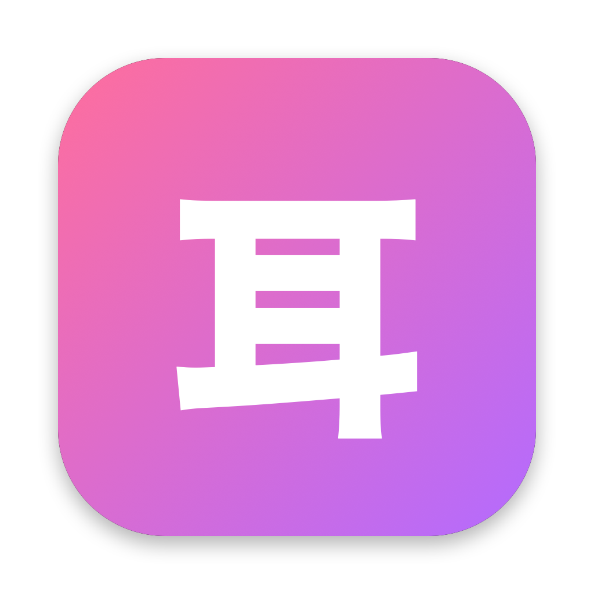
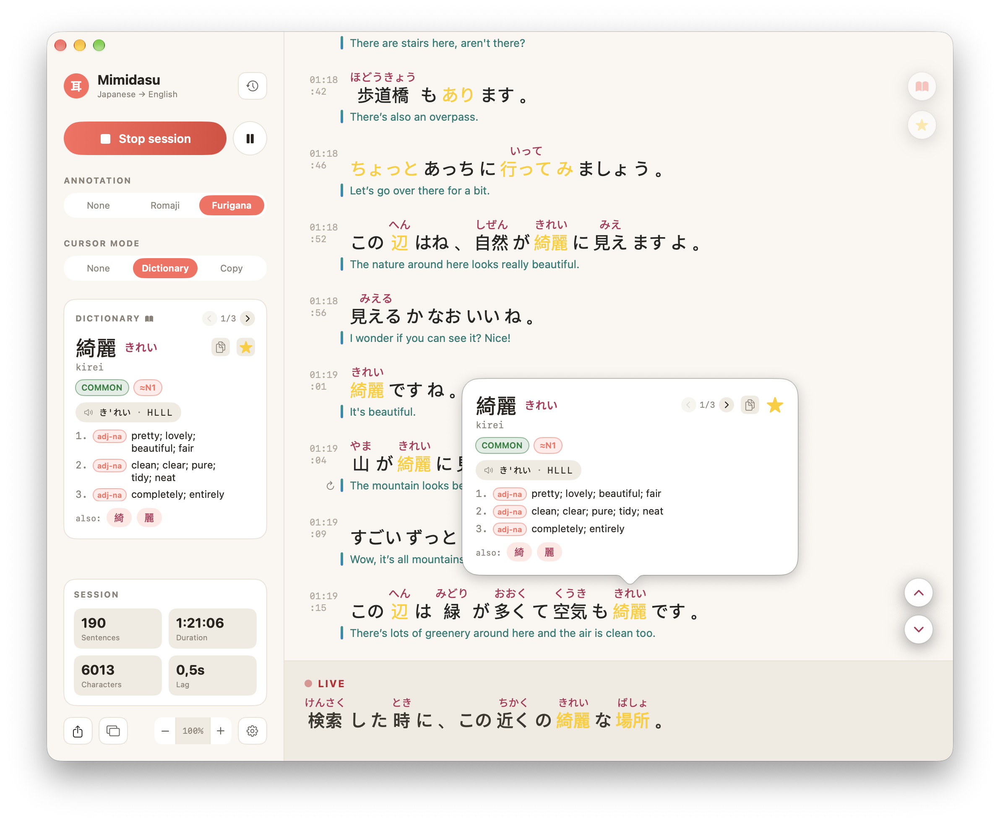

<div align="center">



# Mimidasu

**Live translated subtitles for anything Japanese on your Mac.**

Mimidasu listens to whatever your Mac is playing — a livestream, a video, a
voice chat — and turns the Japanese speech into translated subtitles in real
time. No accounts, no uploads, no tracking: transcription and on-device
translation stay on your Mac, and cloud translation is an opt-in you control.

[](LICENSE.md)
[](#requirements)
[](#requirements)

<a href="https://apps.apple.com/app/id6813053867">
  <picture>
    <source media="(prefers-color-scheme: dark)" srcset="Docs/download-mas-white.svg">
    
  </picture>
</a>

</div>

**The name is a pun.** 見出す (*miidasu*) is Japanese for "to spot, to
discover." Add one more ミ and the word gains an 耳 (*mimi*, ear): **ミミダス**
— *the ear that surfaces words*. Exactly what the app does; it even works as
a verb, because every definition popup is a little *mimidasu*.

<p align="center">
  
</p>

## Level-up your Japanese listening

- **Understand while it happens** — sentences appear as they're spoken, using
  the on-device Lite or Full speech model, with the translation right under
  the Japanese
- **Pick your translation language** — English by default, with 18 more
  targets (Chinese, Korean, Spanish, French, …) available in Settings —
  on-device via Apple's Translation framework, with Apple Intelligence high
  fidelity where available, or through an optional cloud provider (Google,
  DeepL, OpenRouter, OpenAI, Anthropic, Moonshot, Z.ai, DeepSeek, xAI) using
  your own API key
- **Private by design** — audio and transcription never leave your Mac, and
  translation runs on-device unless you opt into a cloud translation provider
- **Learn as you watch** — toggle furigana or romaji over the transcript, and
  click any word for definitions, pitch accent, and JLPT level
- **Add favorites, spot them in the wild** — favorite words appear
  amber-colored in the transcript, inflected forms included (見る also
  highlights 見た and 見ます), keep an eye out for your favorite words while listening!
- **Pause and resume** — suspend a live session without ending it, then pick
  up where you left off
- **Keep and revisit** — every stopped session stays in an on-device archive
  (the newest 10 in Recent, plus a Saved tier); reopen, rename, export, or
  re-translate a whole session into another language
- **Floating subtitles** — a click-through HUD overlays the video you're
  watching, so Mimidasu stays out of the way
- **Keep the transcript** — export any session as TXT, SRT, VTT, or JSON

## Requirements

- Apple Silicon Mac, macOS 15.5+
- macOS 26.4+ for Apple Intelligence high-fidelity translation (optional)
- Internet connection for the first-launch model download (and any cloud
  translation provider you enable)

## Quick start (from source)

```bash
xcode-select --install                        # if not installed
brew install xcodegen cmake ninja zstd rust   # build dependencies
scripts/bootstrap.sh                          # one-time setup
scripts/build_all.sh                          # ASR runtime, tokenizer, dictionaries
open Mimidasu.xcodeproj                       # then ⌘R
```

On first launch you pick a speech model — Lite or Full — and it downloads
automatically; press **Start** and grant system-audio access when prompted.

## Development

- `scripts/test.sh` — tests + coverage (Swift Testing)
- `scripts/lint.sh` — swiftformat + swiftlint
- See `ARCHITECTURE.md` for design notes

## Support Mimidasu 💛

Mimidasu is a labor of love — every feature is free. I built this because I
couldn't find anything like this that is completely free. If Mimidasu makes
your Japanese learning, listening, or content workflow easier, please consider
sponsoring the project. Every contribution — big or small — helps keep
the project alive, free, and improving.

## License

Mimidasu is Copyright (C) 2026 Aulia Sufian Adi.

- **Source code** (and any build distributed outside the Mac App Store):
  [GNU AGPL-3.0](LICENSE.md)
- **Mac App Store build**: governed by Apple's standard Licensed
  Application EULA — see [LICENSE-MAS.md](LICENSE-MAS.md)

Third-party components are documented in
[THIRD_PARTY_NOTICES.md](THIRD_PARTY_NOTICES.md).
